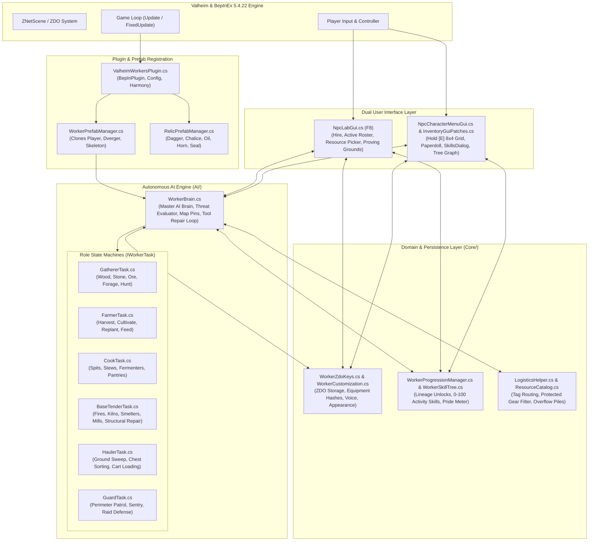
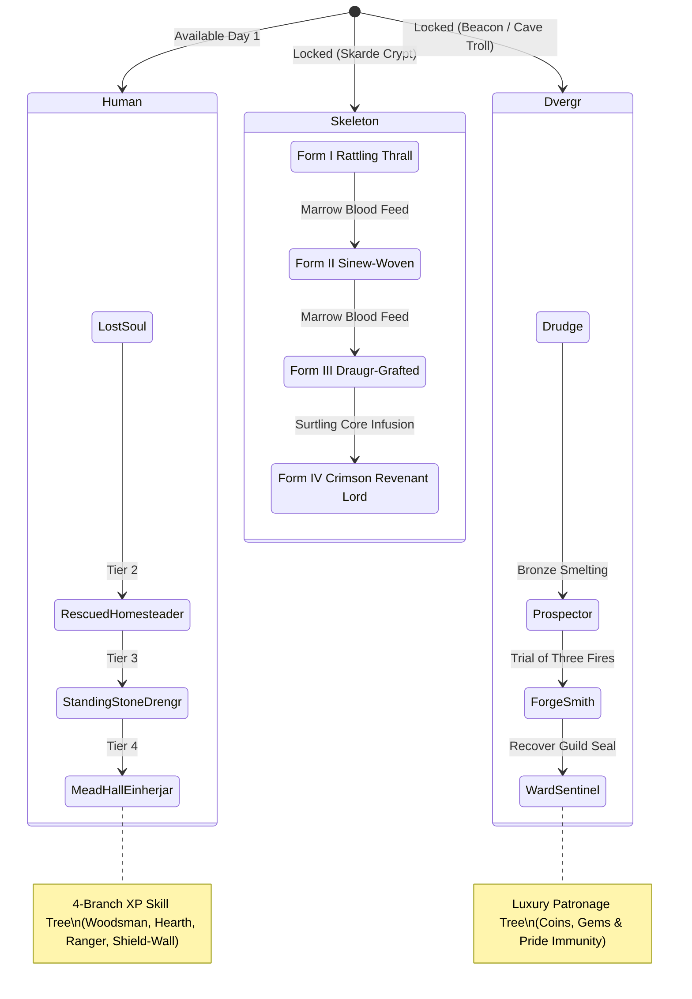

# ValheimWorkers Architecture & Technical Specification (v0.3.0)

This document provides a comprehensive technical breakdown of the architecture, algorithmic loops, persistence layer, and Harmony patching topology powering **ValheimWorkers**.

---

## 1. High-Level System Architecture



---

## 2. Autonomous AI Engine (`AI/WorkerBrain.cs`)

`WorkerBrain` is attached to every spawned worker character and serves as the master decision engine:

### A. Lifecycle & Decision Pipeline
1. **Periodic Ticking (Staggered Performance):** To maintain 60+ FPS with dozens of active NPCs, brains tick on staggered intervals rather than every frame.
2. **Global Threat Preemption:**
   - Evaluates nearby hostiles within `18m` using the **Combat Balance Evaluator**.
   - Compares ally power vs. enemy threat score.
   - *Manageable threat:* Auto-equips best weapon + shield and engages.
   - *Overwhelming threat or HP < 25%:* Triggers tactical retreat, shouts warning, and flees to `HomePosition` or nearest Guard.
3. **Task Delegation (`IWorkerTask`):**
   - Dispatches work execution to the assigned role task (`GathererTask`, `FarmerTask`, `CookTask`, `BaseTenderTask`, `HaulerTask`, `GuardTask`).
4. **Tool Durability & Auto-Repair Cycle:**
   - Monitors equipped tool durability. When durability drops below threshold (`< 35%`), worker interrupts current chore, navigates to the nearest covered Workbench/Forge, plays repair animation, restores item to 100%, and returns to work.
5. **Nocturnal Schedule & Rest:**
   - Assigned beds allow workers to sleep between 21:00 and 06:00, regenerating stamina and health buffs.

---

## 3. Asymmetric Lineages & Progression Architecture



---

## 4. ZDO Persistence Model (`WorkerZdoKeys.cs`)

All worker state is synchronized across multiplayer sessions and persisted in world saves via Valheim's native `ZDO` dictionary:

| Key | Type | Description |
| :--- | :--- | :--- |
| `VW_WorkerName` | `string` | Display name of the worker |
| `VW_WorkerRole` | `int` | Current assigned role enum |
| `VW_WorkerLineage`| `int` | Lineage (0 = Human, 1 = Dvergr, 2 = Skeleton) |
| `VW_WorkerLevel` | `int` | Overall character level (1–50) |
| `VW_WorkerXP` | `float` | Current task XP progress |
| `VW_SkillPoints` | `int` | Unspent skill points for tree abilities |
| `VW_MarrowBlood` | `float` | Skeleton blood reservoir for evolution |
| `VW_HomePos` | `Vector3` | Camp anchor / chest drop-off position |
| `VW_WorkPost` | `Vector3` | Work area center coordinates |
| `VW_WorkRadius` | `float` | Operation boundary radius (5m–150m) |
| `VW_PrideMeter` | `float` | Dignity & pride percentage (0.0–1.0) |
| `VW_EquipHashes` | `byte[]` | Serialized item hashes for visual gear |

---

## 5. Harmony Patch Architecture

The mod hooks seamlessly into Valheim's runtime using Harmony:

```
Patches/
├── BloodSacrificePatches.cs   # Intercepts animal death for Sacrificial Dagger & Chalice
├── ConsolePatches.cs          # Debug / devmode console commands
├── DurabilityPatches.cs       # Custom durability consumption scaling
├── EquipmentPatches.cs        # Visual model and bone attachments for NPC gear
├── GuiInputPatches.cs         # Mouse lock/unlock & camera pause during F8 UI
├── HunterPatches.cs           # Ballistic projectile trajectory & target lead
├── InteractionPatches.cs      # [E], [Shift+E], [Alt+Hold E] world interaction hooks
├── InventoryGuiPatches.cs     # Native 8x4 container grid & Character Sheet drawer
├── MaterialManPatch.cs        # Dynamic material tinting for custom hair/skin/armor
├── MonsterAIPatches.cs        # Prevents worker friendly-fire and handles target aggro
└── ZNetScenePatches.cs        # Registers custom worker and relic prefabs into ZNetScene
```

---

## 6. Build & Deployment Pipeline

Compilation uses Visual Studio 2022's `MSBuild.exe` and targets `.NET Framework 4.7.2`:

```powershell
powershell.exe -ExecutionPolicy Bypass -File "d:\valheim_mods\build.ps1"
```

1. Reads configuration from [`Directory.Build.props`](file:///d:/valheim_mods/ValheimWorkers/Directory.Build.props).
2. References managed assemblies from `D:\Steam\steamapps\common\Valheim\valheim_Data\Managed`.
3. Targets BepInEx plugins directory at `%APPDATA%\r2modmanPlus-local\Valheim\profiles\Default\BepInEx\plugins\ValheimWorkers\`.
4. Copies compiled `ValheimWorkers.dll` directly to the active r2modman profile for instant testing.
