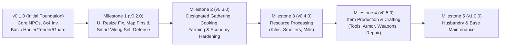

# ValheimWorkers — Development Roadmap & Definition of Done

> [!IMPORTANT]
> This document defines **where `ValheimWorkers` is today (`v0.3.0`)**, **where we are going (`v0.4.0` – `v1.0.0`)**, the exact features planned for each milestone, and the **Definition of Done (DoD)** required to mark each feature and milestone complete.

---

## 1. Executive Overview: Where We Are vs. Where We Want To Be

| Capability Pillar | Where We Are Today (`v0.3.0`) | Where We Want To Be (Target Vision) |
| :--- | :--- | :--- |
| **NPC Spawning, Visage & Inventory** | **Done:** Custom Vikings (Male/Female), Dvergr, Skeletons; full `8x4` container inventory; live visual gear sync; configurable voice/sound profiles; ZDO persistence; recruitment costs enforced in survival; real item transfers. | Outpost waypoint management and multi-island logistics. |
| **F8 UI & World Map Integration** | **Done:** Responsive screen-space resizing from both corners (`◣`/`◢`) and edges; live map/minimap pins; designated resource picker; F8 Proving Grounds scenarios; duty radius slider (`5m–150m`). | Multi-settlement overview and automated caravan paths. |
| **Combat & Self-Defense** | **Done:** All workers defend against manageable foes; hunter-grade ballistic archery (`F18`); tactical CQC swap (`F19`); raid war horn alerts (`F22`); tactical retreat from overwhelming threats (`F17`). | Dedicated siege warfare and catapult operations. |
| **Resource Gathering & Farming** | **Done:** Multi-resource designation (Wood, Stone, Ores, Wildlife, Foraging); tool tier checks; unarmed fallbacks; **`FarmerTask`** (`F11`-`F15` harvesting, cultivated spacing, proactive planting, tamed animal feeding). | Automatic beehive expansion and sap collector networking. |
| **Camp Drop-Off & Storage Logistics** | **Done:** Separate Camp (`HomePosition`) and Work Area (`WorkPostPosition`); smart chest stack sorting; sign-based container routing (`F31`); mobile cart container loading (`F32`); overflow resource piles (`F05`). | Cross-island maritime shipping routes. |
| **Cooking & Food Production** | **Done:** **`CookTask`** mounts raw meats on spits, pulls cooked food before burning into coal (`F23`), cauldron stews (`F24`), fermenter mead tapping (`F25`), and pantry sorting (`F26`). | Advanced feasts and high-comfort banquet hall serving. |
| **Resource Processing & Refining** | **Done:** `BaseTenderTask` fuels campfires and sconces (`F27`), continuous kiln & smelter batching (`F28`), windmill barley milling and spinning wheel loading (`F29`). | Blast furnace dark-metal refining presets. |
| **Item Production (Crafting & Repair)** | **Done:** Autonomous covered Workbench repair cycles (`F20`) restoring tool durability to 100%; base structural repair with Hammer (`F30`). | Automated Forge weapon forging and armor tailoring. |

---

## 2. Current Baseline (`v0.1.0` — Completed Foundation)

The following systems are already implemented in [ValheimWorkers](file:///D:/valheim_mods/ValheimWorkers/ValheimWorkers):
- [x] **Prefab Registration & Cloning** ([WorkerPrefabManager.cs](file:///D:/valheim_mods/ValheimWorkers/ValheimWorkers/Prefabs/WorkerPrefabManager.cs)): Clones `Player`, `Dverger`, and `Skeleton_NoArcher` into ZNet-registered worker prefabs with `Character.Faction.Players`.
- [x] **Persistent Customization & Audio** ([WorkerCustomization.cs](file:///D:/valheim_mods/ValheimWorkers/ValheimWorkers/Core/WorkerCustomization.cs)): Saves name, model, hair, beard, colors, equipment hashes, max HP, work radius, and voice settings to ZDO.
- [x] **Native `8x4` Inventory Grid** ([InventoryGuiPatches.cs](file:///D:/valheim_mods/ValheimWorkers/ValheimWorkers/Patches/InventoryGuiPatches.cs)): `Hold [E]` opens native Valheim container UI; right-clicking equips/unequips gear on the worker with cyan highlight boxes.
- [x] **Foundational Tasks** ([HaulerTask.cs](file:///D:/valheim_mods/ValheimWorkers/ValheimWorkers/AI/HaulerTask.cs), [BaseTenderTask.cs](file:///D:/valheim_mods/ValheimWorkers/ValheimWorkers/AI/BaseTenderTask.cs), [GuardTask.cs](file:///D:/valheim_mods/ValheimWorkers/ValheimWorkers/AI/GuardTask.cs)): Basic ground pickup, fire/smelter fueling, and guard post defense.

---

## 3. Phased Development Roadmap & Definitions of Done

### Milestone 1: UI Overhaul, Map Visibility & Smart Viking Self-Defense (`v0.2.0`)
**Goal:** Fix the `F8` window usability issues, put every worker on the Minimap/World Map, and make sure workers act like smart Vikings who fight manageable enemies and retreat from overwhelming monsters.

#### Planned Features
1. **Responsive Multi-Corner Window Resizing & Adaptive Layout** ([NpcLabGui.cs](file:///D:/valheim_mods/ValheimWorkers/ValheimWorkers/UI/NpcLabGui.cs))
   - Screen-space mouse drag tracking (`Input.mousePosition`) so fast mouse movement never drops the resize handle.
   - Large `34x34` interactive grips in **both bottom-left (`◣`) and bottom-right (`◢`) corners**, plus draggable left/right/bottom borders and header size presets (`Compact`, `Standard`, `MaxFit`).
   - Proportional column layout so panels resize cleanly without clipping.
2. **Live Worker Minimap & World Map (`M`) Pins** ([WorkerBrain.cs](file:///D:/valheim_mods/ValheimWorkers/ValheimWorkers/AI/WorkerBrain.cs))
   - Dynamic `Minimap.PinData` (`save = false`) per active worker updated in real time with role icon, worker name, current role, and alert tags (`[Missing Tool]`, `[Retreating!]`).
   - **"Locate on Map"** button in the `F8` Roster Inspector and a global toggle for worker map pins.
3. **Smart Viking Self-Defense & Threat Assessment** ([WorkerBrain.cs](file:///D:/valheim_mods/ValheimWorkers/ValheimWorkers/AI/WorkerBrain.cs))
   - Global threat preemption layer running for **all roles** (`Gatherer`, `Hauler`, `BaseTender`, `Guard`, `Idle`).
   - **Combat Balance Evaluator**: Compares `Worker + Nearby Allies Power` (HP, best weapon/shield in inventory, armor, allies within `18m`) against `Enemy Threat Score` (`MaxHP`, 1-star/2-star multipliers, apex monster flags like `Troll`, `Bjorn`/Bear, `Abomination`, `StoneGolem`, `Lox`).
   - **Fight vs. Retreat Execution**:
     - *Manageable threat*: Worker auto-equips best combat weapon + shield from inventory, kills the attacker, and resumes their work task.
     - *Overwhelming threat or HP $< 25\%$*: Worker shouts a warning, sprints back to `HomePosition` (or nearest `Guard`/Player), and waits until the threat clears.

#### ✅ Definition of Done (Milestone 1 — Complete)
- [x] Dragging either the **bottom-left (`◣`)** or **bottom-right (`◢`)** corner of the `F8` window smoothly resizes the window at any mouse speed without losing grip or overlapping scrollbars.
- [x] Opening the full-screen World Map (`M`) or glancing at the Minimap shows every active worker's live position, name, and role, and removing/dismissing a worker immediately cleans up its pin.
- [x] When a Greydwarf or Skeleton attacks a `Hauler`, `BaseTender`, or `Gatherer`, the worker stops working, switches to their best weapon + shield, kills the enemy, and returns to work.
- [x] When a low-level worker encounters a **Troll** or **high-level Bear** alone, they do **not** suicide-charge; they announce a retreat, sprint back to camp/guards, and log the decision in the Action Log.

---

### Milestone 2: Designated Resource Gathering, Equipment Intelligence & Smart Drop-Off (`v0.3.0`)
**Goal:** Enable full area-based resource gathering (woodcutting, stone collection, ore mining, hunting, foraging) with known-resource filtering, tool verification, unarmed fallbacks, and smart chest drop-off.

#### Planned Features
1. **Known-Resource Catalog & Multi-Resource Designation** (`Core/ResourceCatalog.cs`)
   - Categorized gatherable definitions:
     - **Wood & Forestry**: `Wood`, `CoreWood`, `FineWood`, `Resin`, `GreydwarfEye`
     - **Stone & Mining**: `Stone`, `Flint`, `CopperOre`, `TinOre`, `Bronze` (composite $\rightarrow$ mines Copper + Tin), `IronScrap`, `SilverOre`, `Obsidian`
     - **Hunting & Wildlife**: `RawMeat`, `BoarMeat`, `DeerHide`, `LeatherScraps`, `NeckTail`, `Feathers`, `WolfMeat`, `WolfPelt`, `LoxMeat`
     - **Foraging**: `Raspberry`, `Blueberries`, `Cloudberry`, `Mushroom`, `MushroomYellow`, `Thistle`, `Dandelion`, `Honey`
   - Filtered by `Player.m_localPlayer.IsMaterialKnown()` so only discovered resources can be ordered (plus a Sandbox unlock button in *Proving Grounds*).
2. **Camp Anchor (`HomePosition`) + Gathering Area Post (`WorkPostPosition`) & Radius (`WorkRadius`)**
   - Workers can gather within `WorkRadius` (`5m–100m`) around their **Work Area Post** (e.g., a hunting zone, forest, or copper vein) and haul back to their **Camp Storage Anchor** (`HomePosition`).
3. **Equipment Evaluation, Auto-Equipping & Missing-Gear Notifications** (`AI/GathererTask.cs` & `WorkerBrain.cs`)
   - Scans all 32 slots of the worker's inventory for the required tool (`m_toolTier`) or hunting weapon/ammo and auto-equips it when engaging a target.
   - Displays clear notifications (Speech Bubble + HUD message + Inspector warning badge + HoverText) when an order requires missing gear (e.g., ordering `Bronze` / `CopperOre` with no Pickaxe in inventory).
4. **Toolless / Unarmed Fallback Gathering**
   - **Stone without Pickaxe**: Runs around collecting loose `Pickable_Stone` / `Pickable_Flint` and ground drops; notifies if only boulders remain.
   - **Wood without Axe**: Picks up fallen `Pickable_Branch` and bashes small trees/saplings/bushes (`Beech_small*`, `FirTree_small*`, `Bush*`, `m_minToolTier == 0`) unarmed or with a club/weapon; notifies if only large trees remain.
5. **Full Harvesting & Hunting Execution**
   - **Woodcutting**: Chops `TreeBase`, `TreeLog`, and stumps (`Destructible`) matching axe `m_toolTier`.
   - **Mining**: Navigates to collider surface (`ClosestPoint`) of `MineRock`, `MineRock5` (Copper deposits, boulders), and `Destructible` rocks, applying tool `HitData` synced with attack swings.
   - **Hunting**: Tracks passive wildlife (`Deer`, `Boar`, `Neck`, birds) inside the designated hunting area, uses Bow+Arrows (for Deer/birds) or melee (for Boar/Neck), waits for `CharacterDrop` on death, and sweeps all dropped meat/hides.
6. **Protected Work Gear & Smart Chest Drop-Off**
   - Marks equipped items, best Axe, Pickaxe, Melee Weapon, Bow, Shield, and Arrows as **Protected Gear** so they are never deposited into storage chests.
   - Sweeps nearby drops (`8m`) after breaking a node/killing prey, then returns to `HomePosition` when full or when the area is clear, depositing first into chests that **already contain matching items** before using empty chests.

#### ✅ Definition of Done (Milestone 2 — Complete)
- [x] In `F8` (and via `[Alt + Hold E]`), a player can assign the `Gatherer` role, pick one or multiple **known resources**, set a **Collection Radius (`5m–100m`)**, and optionally set a separate **Work Area Post** and **Camp Storage Post**.
- [x] **Unknown resources** are hidden/locked until discovered by the player (unless unlocked via Proving Grounds sandbox).
- [x] Ordering a worker to collect **Bronze** (or **Copper/Tin**) without a Pickaxe in their inventory immediately triggers a visible notification stating that an **Antler Pickaxe (or better)** is required.
- [x] Ordering a worker to collect **Stone** without a Pickaxe causes the worker to run around picking up loose stones (`Pickable_Stone` / dropped `Stone`) within radius.
- [x] Ordering a worker to collect **Wood** without an Axe causes the worker to pick up fallen branches (`Pickable_Branch`) and bash small trees/saplings/bushes (`m_minToolTier == 0`), while chopping full trees and logs as soon as an Axe is placed in their inventory.
- [x] Ordering a worker to **Hunt** (`RawMeat`, `DeerHide`, `LeatherScraps`, `NeckTail`) in an area around camp causes them to hunt `Deer`/`Boar`/`Neck`, wait for death drops, and collect the meat and hides.
- [x] When inventory fills up (or gathering finishes), the worker walks back to Camp (`HomePosition`), deposits gathered resources into matching chests **without** depositing their tools, weapons, or arrows, and resumes work.

---

### Milestone 3: Resource Processing & Material Refining (`v0.4.0`)
**Goal:** Automate the conversion of raw gathered resources into refined materials (`Coal`, `Bronze`, `Iron`, `Silver`, `LinenThread`, `BarleyFlour`) at camp stations.

#### Planned Features
1. **Full Smelter, Charcoal Kiln & Blast Furnace Automation** (Upgraded `BaseTender` / `ProcessorTask`)
   - Withdraws `Wood` / `FineWood` / `CoreWood` from camp chests to load `CharcoalKiln` (`AddWood` RPC), respecting a configurable **Minimum Wood Reserve** so camp chests are never stripped of all building wood.
   - Withdraws `Coal` + matching Ores (`CopperOre`, `TinOre`, `IronScrap`, `SilverOre`, `BlackMetalScrap`) from camp chests to load `Smelter` / `BlastFurnace` (`AddFuel` & `AddOre` RPCs).
   - Collects smelted metal bars (`Copper`, `Tin`, `Bronze`, `Iron`, `Silver`, `BlackMetal`) and `Coal` from output spawners and stores them in sorted camp chests.
2. **Windmill, Spinning Wheel & Fermenter Support**
   - Loads `Barley` into Windmills, `Flax` into Spinning Wheels, and Mead Bases into Fermenters, hauling finished products to storage.

#### ✅ Definition of Done (Milestone 3 — Complete in v0.3.0)
- [x] A Processor/Tender worker automatically pulls `CopperOre`, `TinOre`, and `Coal` from camp chests, loads the Smelter, and stores the resulting `Copper` and `Tin` bars into chests.
- [x] Charcoal Kilns are loaded with `Wood` when camp storage has wood available and smelters require coal.
- [x] Windmills process Barley into flour, and spinning wheels process Flax into linen thread without loss.
- [x] Zero items are lost or duplicated during chest-to-smelter-to-chest transfers.

---

### Milestone 4: Item Production — Food, Tools, Armor & Weapons (`v0.5.0`)
**Goal:** Allow workers to craft food, tools, weapons, armor, and ammunition at camp crafting stations using refined materials in camp chests.

#### Planned Features
1. **Camp Cooking & Food Production (`CookTask` / `CrafterTask`)**
   - Supports **Cooking Station** / **Iron Cooking Station** (mounting raw `BoarMeat`, `NeckTail`, `DeerMeat`, `LoxMeat` and removing `CookedMeat` before it burns into `Coal`!) and **Cauldron** / **Stone Oven** recipes.
   - Only known food recipes (`Player.IsRecipeKnown`) can be queued.
2. **Smithing & Carpentry (`Workbench` & `Forge` Crafting Orders)**
   - Queue or set target stock counts (e.g., *"Craft 1x Bronze Axe"*, *"Maintain 100x Wood Arrows"*, *"Craft Bronze Armor Set"*).
   - Worker checks nearby station level (`Workbench` / `Forge` + extensions), withdraws required ingredients (`Copper` + `Tin` $\rightarrow$ `Bronze`, `Wood`, `LeatherScraps`, etc.) from camp chests, plays crafting animations at the station, and deposits the crafted item into camp storage.
3. **Self-Sustaining Worker Equipment Loop**
   - If a Gatherer's tool breaks (`m_durability <= 0`) or they lack a required tool (e.g., Pickaxe or Axe), they automatically check covered camp Workbenches to repair equipment to 100% durability!

#### ✅ Definition of Done (Milestone 4 — Complete in v0.3.0)
- [x] A Cook worker takes raw meat from a chest, cooks it on a Cooking Station, and removes the cooked meat into a food chest **before** it turns to coal (`F23`).
- [x] A Cook worker prepares Cauldron stew recipes and taps aged mead casks from fermenters (`F24`, `F25`).
- [x] Gatherers and guards whose tool durability degrades walk back to camp, repair their worn equipment at a covered Workbench to 100% durability (`F20`), and resume gathering.

---

### Milestone 5: Farming, Husbandry & Base Maintenance (`v1.0.0`)
**Goal:** Complete settlement self-sufficiency with crop farming, animal feeding, and post-raid structural repair.

#### Planned Features
1. **Farming & Foraging Plots (`FarmerTask`)**
   - Harvests mature crops (`Carrot`, `Turnip`, `Onion`, `Barley`, `Flax`) and replants seeds using a `Cultivator` while maintaining plant spacing rules.
   - Harvests `Beehive` honey when full.
2. **Animal Husbandry & Feeding**
   - Drops appropriate feed (`Raspberry`/`Mushroom` for Boars, `Barley`/`Cloudberry` for Lox, `Seeds` for Chickens) in pens to keep tamed animals happy and breeding.
3. **Camp Repair (`BuilderTask` / `BaseTenderTask`)**
   - Workers equipped with a `Hammer` scan `WearNTear` pieces within Camp Radius and repair damaged walls, fences, and workbenches after attacks.

#### ✅ Definition of Done (Milestone 5 — Complete in v0.3.0)
- [x] Farmer workers harvest mature crops and replant them on cultivated ground without overcrowding (`F11`, `F12`, `F13`).
- [x] Farmers proactively feed hungry tamed Boars, Wolves, and Lox from camp fodder reserves (`F15`).
- [x] Base Tender workers with a Hammer repair damaged base structures within `HomePosition` radius back to $100\%$ HP (`F30`).
- [x] Logistical surplus overflows into authentic physical Wood and Stone resource piles when chests are full (`F05`).
