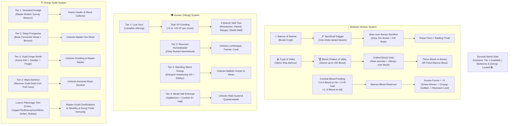

# Worker Origins, Quests, Relics & Asymmetric Skill Trees

This document covers the comprehensive progression, questline origins, and asymmetric skill tree system implemented in **ValheimWorkers**.

---

## 🗺️ High-Level System Architecture

---

## 💀 1. SKELETON WORKERS: RELICS, BLOOD & COMBAT FEEDING

### 🗡️ Relic 1: Skarde's Sacrificial Dagger (`VW_SacrificialDagger`)
- **Origin:** Recovered from the Barrow of Skarde inside Black Forest burial crypts.
- **Butcher's Strike:** One-shots tamed animals (`m_tamed == true`) with lethal damage (99,999 slash).
- **The Ground Sacrifice Ritual:**
  1. Drop a stack of `10+` **BoneFragments** on the ground inside a boar farm or pen.
  2. Lure or wait for a **Boar** (or other beast) to stand within **3.5m** of the dropped bones.
  3. Strike and kill the Boar with the **Sacrificial Dagger**.
  4. The blood splashes across the bones, consumes 10 bones from the stack, plays lightning and blood VFX, and summons a **Skeleton Servant** right out of the earth!
  5. Unlocks the Skeleton lineage permanently in your world.

### 🏆 Relic 2: The Blood Chalice of Valka (`VW_BloodChalice`)
- **Origin:** Recovered from the Crypt of Valka in stone ship barrows.
- **Capacity:** Stores up to **100 Blood Units** in custom item data (`VW_Blood`), dynamically displayed in the tooltip.
- **Harvesting Spilled Blood:**
  - If you kill an animal with the Sacrificial Dagger and there are *no* bones on the ground nearby, the spilled blood is caught and stored in the Chalice.
- **Creature Blood Yield Scale:**
  - `Neck / Seagull / Crow`: **3 Blood**
  - `Boar (Tamed or Wild)`: **10 Blood** *(1 Boar = 1 Basic Skeleton)*
  - `Deer`: **15 Blood**
  - `Wolf / Fenring`: **25 Blood**
  - `Bear (Bjorn) / Troll`: **45 Blood**
  - `Lox`: **75 Blood**
- **Viking's Own Spilled Blood:**
  - **Passive Combat Bleed:** When you carry the Chalice and take physical damage, 40% of the damage is caught as warm blood in the Chalice.
  - **Active Blood-Letting Rite (`Middle-Click` or `G`):** Wielding the Chalice or Dagger, press Middle-Click to slice your palm, dealing 30 damage to yourself and immediately adding **15 Blood** to the Chalice.
- **Throwing Blood (`Left-Click`):**
  - Left-clicking with the Chalice throws 10 Blood onto ground bones (raising a Skeleton Servant), or pours 15 Blood into an existing Skeleton's marrow!

### 🩸 Skeleton Combat Blood-Feeding ("The Thirsting Marrow")
- Every Skeleton Worker has a persistent **Marrow Blood Reservoir (`MarrowBlood`)** stored in its ZDO.
- When fighting living bleeding enemies:
  - **`+0.5 Marrow Blood`** per melee strike landed (plus a **`+2 HP` self-heal** that keeps the skeleton alive in combat).
  - **`+2.0 to +6.0 Marrow Blood`** upon delivering a killing blow to a living creature.
- Accumulated Marrow Blood can be spent directly in the `F8 -> Skills & Evolution` tab to evolve the Skeleton's form or graft blood-only abilities!

### 🦴 Skeleton Evolution Forms (I – IV)
| Form | Name | Base HP | Scale | Requirements | Unlocked Capabilities |
| :---: | :--- | :---: | :---: | :--- | :--- |
| **I** | **Rattling Thrall** | 80 HP | 1.00x | Base Sacrifice (10 Bones + 10 Blood) | `Hauler`, basic `Gatherer`, sentry |
| **II** | **Sinew-Woven Laborer** | 140 HP | 1.06x | 25 Blood + 10 Bones + 4 Raw Meat | Unlocks **`Lumberjack`**, **`Miner`**, Bow |
| **III** | **Draugr-Grafted Hulk** | 190 HP | 1.12x | 35 Blood + 15 Bones + 4 Entrails | Unlocks **`BaseTender`**, **`Farmer`**, heavy mining |
| **IV** | **Crimson Revenant Lord** | 280 HP | 1.20x | 50 Blood + 20 Bones + 3 Surtling Cores | Apex Undead: fearless, high poise |

---

## 🛡️ 2. HUMAN VIKINGS: 4-TIER PROGRESSION & 4-BRANCH SKILL TREE

### 4-Tier Settlement Progression
1. **Tier 1 (Naked Lost Souls):** Available Day 1 in Meadows by offering cooked meat at a campfire (`[Shift + E]`). Starts naked with 0 skills; eager to grind XP on humble tasks.
2. **Tier 2 (Rescued Homesteaders):** Clear a ruined village and recover the *Steward's Ledger*. Unlocks the Settlement Signal Brazier; pre-trained in **Farming, Cooking, and Lumberjacking**.
3. **Tier 3 (Standing Stone Drengr):** Slay Eikthyr and craft *Draupnir Awakening Oil* (`VW_AwakeningOil`). Anoint a standing stone to awaken seasoned **Hunters (`[F18]` ballistic archery)** and **Miners**.
4. **Tier 4 (Mead-Hall Einherjar):** Build a Comfort 6+ Mead Hall, recover a dungeon *Soul-Urn*, and blow the *Gjallarhorn of the Hearth* (`VW_Gjallarhorn`). Unlocks **Elite Guards** and **Master Quartermasters**.

### 4-Branch XP Skill Tree
Low-level human workers gain **Task XP** by completing chores:
- `+5 XP` per hauled item stack or forage item picked
- `+10 XP` per resource stack deposited in camp chests
- `+15 XP` per mature crop harvested, seed planted, meal cooked, or kiln/smelter fueled
- `+20 XP` per base structure repaired with a hammer
- `+25 XP` per animal hunted or enemy slain

Every level-up grants **+1 Skill Point (SP)** to spend across 4 branches in `F8 -> Skills & Evolution`:
1. **🌲 Woodsman & Forager:** Stick & Berry Picker $\rightarrow$ Axeman's Grip (`Lumberjack`) $\rightarrow$ Hardwood Clearcutter (Birch/Oak) $\rightarrow$ Yggdrasil's Harvester (+25% bonus wood drops, 50% less tool durability loss).
2. **🌾 Hearth, Farm & Kitchen:** Campfire Stoker $\rightarrow$ Homestead Cultivator (`Farmer`) $\rightarrow$ Mead-Hall Chef (`Cook`) $\rightarrow$ Grand Feastmaster (20% double cooking yield, +3 HP/s comfort aura).
3. **🏹 Ranger & Delver:** Rock Scavenger $\rightarrow$ Quarry Striker (`Miner`) $\rightarrow$ Eagle-Eye Stalker (`Hunter`) $\rightarrow$ Apex Tracker (+40% draw speed, Wolves/Lox hunting, +1 hide/meat).
4. **⚔️ Shield-Wall & Industry:** Torch Bearer $\rightarrow$ Kiln & Smelter Hand (`BaseTender`) $\rightarrow$ Sworn Huscarl (`Guard`) $\rightarrow$ Einherjar Warlord (+100 Max HP, cleaving melee, ally inspiration).

---

## ⛏️ 3. DVERGR: 4-TIER GUILD PROGRESSION & LUXURY PATRONAGE

### 4-Tier Guild Progression
1. **Tier 1 (Stranded Drudge):** Repair a broken Survey Beacon in Black Forest (`5 Greydwarf Eyes + 1 Surtling Core`). Powerful heavy `Hauler`.
2. **Tier 2 (Deep Prospector):** Brew Fermenter Mead and smelt 10 Bronze bars. Unlocks **`Master Miner`** (+25% pickaxe power, headlamp).
3. **Tier 3 (Guild Forge-Smith):** The Trial of Three Fires: have an active Kiln, Smelter, and Forge roaring within 20m. Unlocks **`Smelting & Camp Repair Master`**.
4. **Tier 4 (Ward-Sentinel):** Slay the Troll in a Black Forest cave and recover the stolen *Grand Dvergr Guild Seal* (`VW_DvergrSeal`). Unlocks **`Armored Ward-Sentinel Guard`** (`300 HP`, damage-reduction Ward Aura).

### 💎 Luxury Patronage Tree
Dvergr do not level up through ordinary chores—they demand **Luxury Patronage** (Coins, Refined Ores, and Rare Gems):
- **Deep-Vein Certification:** `40 Coins + 5 CopperOre + 5 TinOre` $\rightarrow$ Unlocks Miner + +25% mining damage.
- **Jeweler's Eye (Gem-Finder):** `60 Coins + 3 Amber` $\rightarrow$ 15% chance to find bonus gems/coins when mining rock.
- **Master Metallurgist's Seal:** `75 Coins + 5 Bronze` $\rightarrow$ Loads smelters 2x faster, 20% bonus metal bar per batch.
- **Runic Anvil-Wright:** `90 Coins + 5 Iron + 2 Rubies` $\rightarrow$ Repairs base structures and remotely hones nearby tools.
- **Brew-Master & Mill-Engineer:** `80 Coins + 10 FineWood + 1 SilverNecklace` $\rightarrow$ +50% processing speed on Windmills and Fermenters.
- **Svartalfheim Runic Ward:** `150 Coins + 5 Silver + 2 Crystals` $\rightarrow$ +120 Max HP, heavy dwarven armor, and protective Ward Aura.

---

## 😤 4. THE DIGNITY & PRIDE SYSTEM

1. **Low-Tier Workers (Tier 1–2):**
   - Zero ego. Gain **+100% Task XP** from menial chores (hauling, stick picking, foraging) without any morale penalty.
2. **Elite Specialists (Tier 3–4):**
   - High base stats and pre-trained skills.
   - When forced to do menial chores beneath their station (`Task Dignity < Worker Tier - 1`), their **Pride Meter** drains over 5 minutes.
   - **At `< 50%` Pride:** They grumble voice lines and suffer a **`-30% movement speed penalty`**.
   - **At `0%` Pride:** They go on strike and walk back to the campfire/hearth to rest.
3. **Appeasement & Luxury Satisfaction:**
   - **Humans:** Giving consumable food or mead restores +50% Pride.
   - **Dvergr:** Giving Coins (10x), Amber, or Rubies restores Pride to 100%. If a Dvergr holds gems or gold in their inventory, they gain the **"Wealthy & Smug"** buff with **zero pride decay** even while hauling dirt!
4. **Skeletons:**
   - Have **no ego or pride** whatsoever. Even an Apex Form IV Revenant Lord will silently haul turnips or pick up stones for eternity without complaint.

---

## 🎮 5. IN-GAME `F8` UI CONTROLS

- **Tab 1: Hire & Customize:**
  - Displays body heritage buttons with live unlock status (`Dvergr 🔒`, `Skeleton 🔒`).
  - Displays discovery clues and quest objectives for locked lineages.
- **Tab 2: Active Roster $\rightarrow$ Inspector Sub-Tab 3: `"Skills & Evolution"`:**
  - Live Level, Task XP bar, and Pride status.
  - Interactive Human 4-Branch Skill Tree with `[Learn (X SP)]` buttons.
  - Interactive Skeleton Evolution panel with Marrow Blood display, Form Evolution upgrades, and Blood Grafts.
  - Interactive Dvergr Patronage panel with Guild Certification buttons.
- **Tab 3: Proving Grounds & Sandbox:**
  - `💀 Blood Sacrifice Scenario`: Spawns the Sacrificial Dagger, Blood Chalice (50 blood), 20x ground bones, and a tamed Boar 3m ahead for instant sacrifice testing.
  - One-click buttons to give any relic (`Sacrificial Dagger`, `Blood Chalice`, `Awakening Oil`, `Gjallarhorn`, `Dvergr Seal`).
  - `Toggle Sandbox Unlock All` button for instant testing of all tiers and lineages.

---

## 🛡️ 6. PLAYER-STYLE NPC CHARACTER MENU & SKILLS (0–100)

Every worker features a comprehensive **Player-Style Character Menu** that mirrors Valheim's native player UI (`InventoryGui` + `SkillsDialog`), accessible both directly in the world and from the Settlement Hall.

### 🎮 Dual In-Game Entry Points
1. **Hold `[E]` on Worker (Native Container View):**
   - Alongside the worker's `8x4` container inventory, docks an adjacent **Worker Vitals & Header Side-Drawer**.
   - Displays Worker Avatar, Name, Lineage badge, Total Armor rating badge (`🛡️ XX`), Carried Weight (`⚖️ XX / Max kg`), Health, Stamina / Marrow Blood, and 3 active food buff timers.
   - Includes top-right action icon buttons matching the player's UI:
     - `[⚔️ Skills]`: Opens the `0–100` SkillsDialog list!
     - `[🌳 Skill Tree]`: Opens the Heritage Skill Tree & Evolution window!
     - `[🛡️ Full Sheet]`: Opens the full Paperdoll & Attributes view!
2. **Press `[F8]` Settlement Hall Inspector:**
   - Active Roster includes a `"View Character Sheet & Skills"` button opening the full 3-tab window.

### 📋 The 3 Switchable Character Menu Views
1. **Tab 0: Character Sheet & Paperdoll:**
   - **Equipped Paperdoll Slots:** Visual slots for Helmet, Chest, Legs, Main Hand, Off-Hand (Shield), Cape, Bow, and Ammo. Right-clicking items in the `8x4` container below equips/unequips them with native cyan frames.
   - **Vitality & 3 Sustenance Slots:** Health bar, Stamina bar (or Marrow Blood for Skeletons), 3 food buff slots with live expiration countdown timers (`⏱️ mm:ss`), and Pride / Mood meter with one-click `[Appease Pride]` button.
   - **Combat & Work Attributes:** Total Armor rating, Carried / Max Weight, Weapon Damage & Tool Tier, Bow Pierce Damage & Draw Speed, Shield Block Power & Parry Factor, Movement Speed %, Work Efficiency %, and Cold Resistance.
2. **Tab 1: Valheim Activity Skills (`0–100`):**
   - Faithful clone of Valheim's iconic `SkillsDialog`.
   - Tracks 8 Activity Skills: *Woodcutting, Mining, Melee Combat, Blocking, Bows & Archery, Farming & Forage, Cooking & Crafting, and Athletics & Hauling*.
   - Each row displays: Skill Icon, Skill Name, Level badge (`Lv. X / 100`), dual fill bars (Level bar + Next-level XP progress `XP: X% -> Y`), and Active Passive Bonus text.
   - Performing work actions grants skill XP; leveling up an activity skill awards character overall XP, increasing overall Level and granting **Skill Points (`SP`)**!
3. **Tab 2: Heritage Skill Tree & Evolution Node Graph:**
   - Visual connected node graph for Human 4 branches x 4 tiers, Skeleton 4-stage Evolution spine + 6 anatomical blood-grafts, and Dvergr 6 luxury patronage nodes.
   - Node Inspector card with one-click Learn / Evolve actions.

### 🌐 Interactive HTML Prototype
A standalone, high-fidelity visual prototype of this UI is available for browser inspection at:
- [npc_character_menu_preview.html](file:///d:/valheim_mods/ValheimWorkers/npc_character_menu_preview.html)

